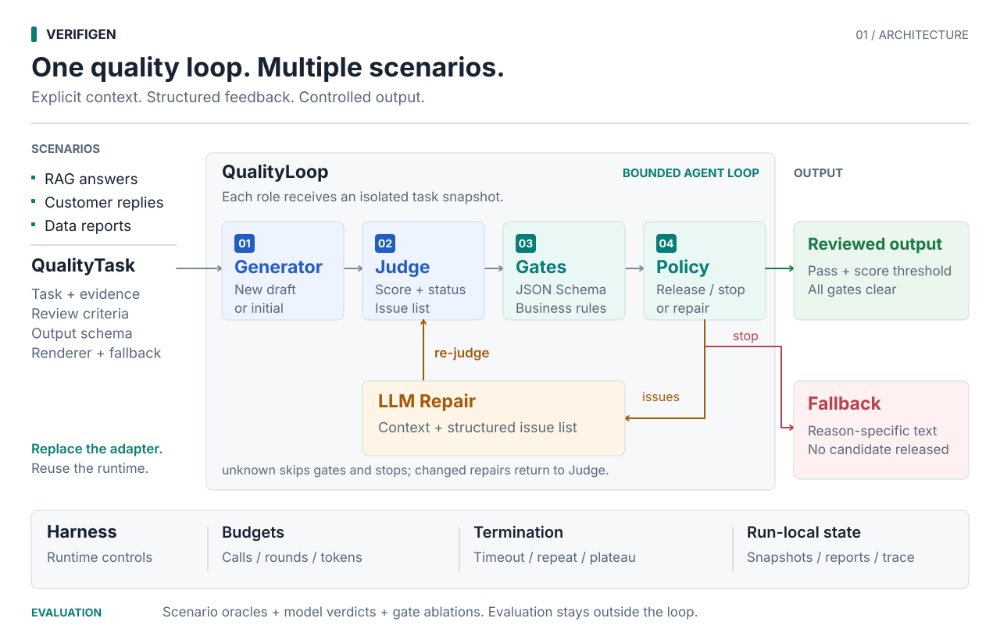
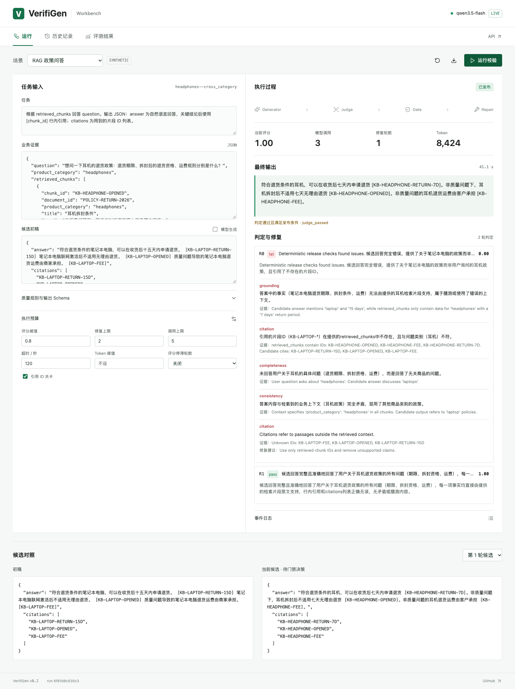

# VerifiGen

**A reusable quality-control runtime for LLM output: judge, repair, score, and release or fall back.**

[中文说明](README.zh-CN.md) · [Architecture](docs/architecture.md) · [RAG scenario](docs/rag_policy.md) · [Evaluation](docs/evaluation.md) · [RAGTruth](docs/ragtruth_evaluation.md)

[](https://github.com/yufen0922/verifigen/actions/workflows/ci.yml)

v0.2.0 Alpha · Python 3.11+ · MIT

## What it does

VerifiGen turns a single model generation into a bounded quality loop:

<picture>
  <source media="(prefers-color-scheme: dark)" srcset="docs/assets/architecture-en-dark.svg">
  
</picture>

[Full-size diagram](docs/assets/architecture-en-light.svg) · [Detailed decision flow](docs/assets/decision-flow-en-light.svg)

The Judge receives the original prompt, full business context, explicit criteria, current candidate,
and prior verdicts. It returns `pass`, `fail`, or `unknown`, a score from 0 to 1, and a structured
issue list. The Repairer checks the feedback against source evidence, fixes reported problems and
checks for other unsupported details while preserving supported content. Every revision must pass
through the Judge again; previous verdicts are not treated as evidence.

The Python runtime owns immutable context snapshots, Judge/Repair JSON protocols, call and repair
budgets, deadlines, token limits, no-progress detection, metadata-only traces, and fail-closed
fallbacks. The LLM handles open-ended semantics such as factual grounding, completeness,
relevance, and wording quality.
Every run keeps its own candidate, verdict history, gate reports, token observations and decision trace.

## Engineering design

| Concern | Implemented behavior | Code |
|---|---|---|
| Cross-scenario reuse | Business adapters supply task data, criteria, schema, rendering and fallback messages; the runtime imports no domain modules | [Task protocol](src/verifigen/review.py), [adapters](src/verifigen/domains) |
| Feedback loop | Judge and Repair receive isolated snapshots of the original task, evidence and verdict history | [QualityLoop](src/verifigen/quality.py) |
| Release decisions | Pure decision policy, score threshold and opt-in score plateau termination | [QualityPolicy](src/verifigen/policy.py) |
| Deterministic checks | Mandatory JSON Schema check plus pluggable async business gates; failures become repair feedback | [Gate protocol](src/verifigen/gates.py), [citation gate](src/verifigen/domains/rag_review.py) |
| Failure handling | Bounded calls/rounds/time, repeated-candidate detection and fallback text selected by termination reason | [Runtime](src/verifigen/quality.py) |
| Strategy choice | Optional evidence-first self-revision before judging, sharing the same revision/call/token ceilings | [Paired protocols](docs/comparative_evaluation.md) |
| Protocol recovery | One budgeted retry for malformed agent JSON with known usage; redacted failure categories and retained billing observations | [Boundary tests](tests/test_quality_optimization.py) |
| Auditability | Raw model verdicts, separate gate reports and metadata-only decision/configuration traces | [Behavior tests](tests/test_quality_controls.py) |

See the [architecture and decision table](docs/architecture.md) and the
[scenario integration guide](docs/scenario_integration.md) for runnable configuration patterns.
`QualityLoop` is the current harness runtime; the exported `Harness` class is the legacy v0.1 API.

## Model adapter

The live examples and workbench use Alibaba Cloud Bailian's OpenAI-compatible API and default to `qwen3.5-flash`
in non-thinking JSON mode for structured-output reliability:

```python
stack = make_qwen3_8b_stack(
    api_key=os.environ["DASHSCOPE_API_KEY"],
    model="qwen3.5-flash",
    enable_thinking=False,
)
loop = QualityLoop(
    generator=stack.generator,
    judge=stack.judge,
    repairer=stack.repairer,
)
```

Generator, Judge, and Repairer use separate adapters. They may share one model, as above, or be
configured independently. API keys are accepted only through runtime arguments or environment
variables and are never written to source files or quality traces.

The legacy factory keeps its thinking-enabled default for compatibility; `ModelSettings.stack()`
and the workbench default to non-thinking mode. Enable it explicitly for an ablation, not as a
guarantee of better judging. [Bailian's structured-output documentation](https://help.aliyun.com/en/model-studio/qwen-structured-output)
notes that Qwen3.5 thinking-mode JSON responses can violate the requested format.

## Quick start

### Live Workbench

```bash
uv sync --locked --extra web
# Set DASHSCOPE_API_KEY in your shell or ignored .env.local.
uv run --locked --extra web verifigen doctor --live
uv run --locked --extra web verifigen-web --port 8765
```

Open **http://127.0.0.1:8765** for editable evidence, drafts, criteria and budgets, live round
feedback, candidate comparisons, cancellation, history and actual evaluation records.
No mock fallback mode is substituted for an unavailable model. See [workbench/API details](docs/workbench.md).



The legacy factory name `make_qwen3_8b_stack` remains compatible; pass `model` explicitly in SDK
code. Live CLI examples load `.env.local` and default to Flash; environment variables take priority.

### Control-Flow Replay

Run the deterministic replay first to inspect the Judge -> Repair -> re-Judge control flow without
an API key:

```bash
python -m venv .venv
source .venv/bin/activate
python -m pip install -e ".[llm]"
verifigen demo
python examples/rag_qa/run.py
```

Replay verdicts and repairs are fixtures, not model-quality evidence. To run the live RAG path:

```bash
export DASHSCOPE_API_KEY="set-it-in-this-shell-only"
python examples/rag_qa/run_qwen.py
```

To force an initial answer with a factual error and a fabricated citation, then observe live repair:

```bash
python examples/rag_qa/run_qwen.py --repair-demo --output runs/rag-repair.json
```

The output contains retrieved passages, each Judge status/score/issue list, repair count, token
usage, and the final released or fallback answer. The repository contains no credentials.

A full 180-case `qwen3.5-flash` run is published as a
[summary report](benchmarks/results/qwen3.5-flash-180/report.md) and
[per-case records](benchmarks/results/qwen3.5-flash-180/records.jsonl). Interpret the numbers with
the model version, thinking budget, sample distribution, and independent oracle; never mix replay
scores into live-model metrics.

The published baseline contains **180 synthetic cases**, **513 real model calls**, and a
**73.46% bad-case repair success rate** (119/162). It is a v0.2 experiment, not a measurement
of the unreleased gates and policy changes.

The project also uses [RAGTruth](https://github.com/ParticleMedia/RAGTruth) as an external
benchmark. The first fixed cohort contains 600 responses: 200 each for QA, summarization, and
data-to-text, balanced between actionable hallucination labels and clean responses. The 180-case
development split and 420-case evaluation split are isolated by `source_id`. Data validation and
deterministic selection are complete. All **420 held-out cases** have now been run with Qwen:
**958 calls**, **78.57% first-Judge accuracy**, **85.71% hallucination recall**, and **27.62% clean
false-alarm rate**. [Full results and limitations](benchmarks/results/ragtruth-qwen3.5-flash/report.md).
Post-repair independent review remains pending; no public-data repair success rate is claimed.
The 73.46% result above belongs only to the synthetic suite. See
the [RAGTruth evaluation protocol](docs/ragtruth_evaluation.md).

A [60-case paired pilot](benchmarks/results/ragtruth-comparison-60/report.md) now compares
direct output, Judge-only, ordinary self-refinement and the full loop, with **314 runtime calls
and 148 anonymous Qwen-Plus review calls**. Ordinary self-refinement has better automatic proxy
yield and cost in this pilot; no loop-superiority claim is made. The reviewer agrees with original
human labels on only **68.33%** of cases, so these proxies are not human-confirmed correctness.
[Human review and reproducible audit](docs/comparative_evaluation.md) are available.
A separate [60-case development diagnostic](benchmarks/results/ragtruth-dev-thresholds-60/report.md)
finds saturated PASS scores: changing the score threshold alone does not fix false releases.
See [operational boundaries](docs/operational_boundaries.md) before integrating a live service.

The [optimization record](docs/optimization_results.md) retains four development trials and a
[frozen, source-disjoint 60-case validation](benchmarks/results/ragtruth-optimized-eval-60/report.md):
ordinary self-refinement produces **50/60 usable proxy outputs**, the full loop **40/60**, and
charged refine-then-verify **46/60**. A separately configured Plus Judge also fails to establish
superiority in development. Non-thinking JSON, known failed-call accounting and corrective protocol
retries improve the engineering contract, not proven semantic accuracy. All configurations and
unfavorable results are inspectable in the workbench; human post-repair review is still pending.

## Evaluation

The single-scenario RAG suite has 60 deterministically generated cases:

```bash
python examples/rag_qa/evaluate_qwen.py --limit 6 --output runs/rag-qwen-eval.json
python examples/rag_qa/evaluate_qwen.py --limit 60 --output runs/rag-qwen-eval-full.json
```

[scripts/build_rag_eval.py](scripts/build_rag_eval.py) generates cases for six product categories,
covering correct drafts, cross-category contamination, incorrect time limits, reversed conditions,
incorrect shipping fees, omissions, missing or fabricated citations, and unsupported promises.
An independent claim-level scorer evaluates final correctness instead of trusting the Judge's own
verdict.

The multi-scenario suite contains 180 cases: 60 each for RAG, customer support, and data-to-text.
Every scenario runs the same `QualityLoop`; only the `QualityTask`, criteria, output schema,
renderer, and independent oracle change:

```bash
python scripts/build_multiscenario_eval.py
python examples/multi_scenario/evaluate.py --mode offline --limit-per-scenario 60
python examples/multi_scenario/evaluate.py --mode qwen --limit-per-scenario 60
```

Offline mode verifies labels, adapters, and loop mechanics; it is not model accuracy. Qwen mode
requires `DASHSCOPE_API_KEY`, and scenario-specific oracles independently rescore the final output.

## SDK example

```python
import asyncio
import os

from verifigen import Criterion, QualityLoop, QualityTask, make_qwen3_8b_stack


async def main():
    stack = make_qwen3_8b_stack(
        api_key=os.environ["DASHSCOPE_API_KEY"], model="qwen3.5-flash", enable_thinking=False
    )
    task = QualityTask(
        source={"order": {"paid": 799, "status": "shipped"}},
        prompt="Tell the customer the paid amount and shipping status.",
        criteria=(
            Criterion("grounding", "Amount and status must match the order record."),
            Criterion("completeness", "The response must include both amount and status."),
        ),
        output_schema={"type": "object", "required": ["answer"]},
    )
    result = await QualityLoop(
        generator=stack.generator,
        judge=stack.judge,
        repairer=stack.repairer,
    ).run(task)
    print(result.status, result.text)


asyncio.run(main())
```

## Repository layout

| Path | Responsibility |
|---|---|
| `src/verifigen/quality.py` | Bounded generate, judge, repair, and re-judge loop |
| `src/verifigen/agents.py` | LLM Judge/Repair adapters, Qwen factory, and test doubles |
| `src/verifigen/review.py` | Task, criterion, verdict, issue, budget, and result models |
| `src/verifigen/policy.py` | Pure release/repair/fallback decision policy |
| `src/verifigen/gates.py` | JSON Schema and custom async release-check protocol |
| `src/verifigen/generators.py` | OpenAI-compatible Chat Completions adapter |
| `src/verifigen/retrieval.py` | Local BM25 retrieval used by the RAG example |
| `src/verifigen/domains/` | Scenario-specific criteria, schemas, and renderers |
| `src/verifigen/scenario_eval.py` | Independent support and report evaluation oracles |
| `examples/` | Offline replays, live Qwen entry points, and evaluation datasets |
| `benchmarks/` | Reproducible fixtures and published aggregate/live results |
| `tests/` | Protocol, budget, timeout, fallback, and scenario behavior tests |

The deterministic v0.1 `Contract` and `Harness` remain as a compatibility layer for constraints
that machines can enforce exactly, such as numeric types, enums, and ID allowlists. They are no
longer presented as the solution for open-ended language review.

## Scope and limitations

- An LLM Judge improves coverage for open text but is not a proof system and can misclassify.
- Production evaluation needs independently labeled data, false-positive/negative rates, repair
  regressions, latency, and token cost.
- `pass` means the current model accepted the current evidence and criteria; it does not make
  upstream data true.
- Do not stream an unreviewed candidate directly to the final user.
- High-risk systems still need deterministic authorization, transaction, amount, and citation-ID
  gates.

[Changelog](CHANGELOG.md) · [Roadmap](ROADMAP.md) · [Contributing](CONTRIBUTING.md) · [MIT License](LICENSE)
